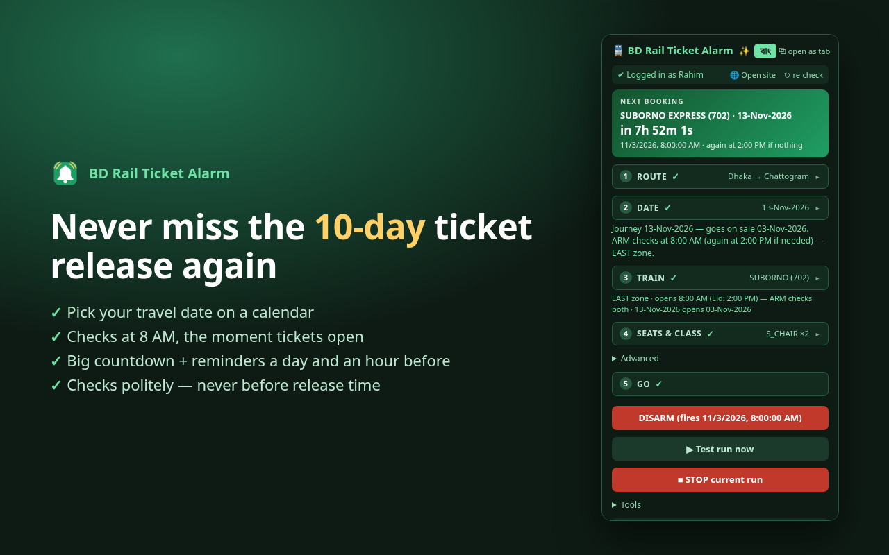

# 🔔 BD Rail Ticket Alarm

**Never miss the 10-day ticket release again.** A free Brave/Chrome extension that watches for your
Bangladesh Railway train the second its tickets go on sale on eticket.railway.gov.bd, rings a loud alarm,
and lights up the BOOK NOW button and good seats. You click, you pay — nothing is booked behind your back.

📖 **Guide:** [English](https://saikatnjm.github.io/bd-rail-ticket-alarm/) · [বাংলা](https://saikatnjm.github.io/bd-rail-ticket-alarm/bn.html)
🔧 **How it works / limits:** [English](https://saikatnjm.github.io/bd-rail-ticket-alarm/how-it-works.html) · [বাংলা](https://saikatnjm.github.io/bd-rail-ticket-alarm/how-it-works-bn.html)
🔒 **Privacy:** [policy](https://saikatnjm.github.io/bd-rail-ticket-alarm/privacy.html)

## Why use it?

Bangladesh Railway tickets go on sale 10 days before the journey, and popular trains often sell out in minutes.
Nobody has time to sit refreshing eticket.railway.gov.bd waiting for the release. BD Rail Ticket Alarm watches for you.
It rings the moment your train opens and takes you straight to BOOK NOW and the best seats, so you're among the first, not the last.

- ⏰ **Never miss the release time.** It works out when your date opens.
- 🔕 **No more endless refreshing.** One alarm, right on time.
- 🪑 **No more hunting for seats.** Good seats are ringed in blue for you.

*Free · English & বাংলা · You still choose, book and pay yourself.*

**কেন ব্যবহার করবেন?** ট্রেনের অগ্রিম টিকিট যাত্রার ১০ দিন আগে ছাড়ে, আর জনপ্রিয় ট্রেনের টিকিট কয়েক মিনিটেই শেষ হয়ে যায়।
এই এক্সটেনশন আপনার হয়ে নজর রাখে, টিকিট খোলামাত্র অ্যালার্ম বাজায় আর সরাসরি BOOK NOW ও সেরা সিটে নিয়ে যায়। [বাংলা গাইড →](https://saikatnjm.github.io/bd-rail-ticket-alarm/bn.html)

## Features

- Calendar date picking — works out the opening day (10 days before) and checks at 8 AM, when tickets open (plus 2 PM for East trains, the Eid-time opening)
- Countdown, plus reminders 1 day and 1 hour before
- Checks for your train at the exact release second, about once a second
- Loud alarm when seats open; scrolls to your train and makes BOOK NOW glow
- Outlines good seats: middle of the coach, side by side for 2+ tickets, or your preferred coaches/seats
- Login indicator, saved trips, recent runs, full English/Bangla UI, classic or glossy glass look

## What it never does

Log in for you · touch the site's bot check (Cloudflare Turnstile) · reserve seats · enter OTP · pay.
It stays polite: no searching before release, ~1 request/second for a few minutes at most, backs off on HTTP 429.
Details and honest limitations: [How it works](https://saikatnjm.github.io/bd-rail-ticket-alarm/how-it-works.html).

## Install

**[⬇ Download bd-rail-ticket-alarm.zip](https://github.com/saikatnjm/bd-rail-ticket-alarm/releases/latest/download/bd-rail-ticket-alarm.zip)** — free, works in Brave, Chrome and Edge on a computer.

1. Unzip it. You get a folder called `bd-rail-ticket-alarm` — keep it somewhere permanent.
2. Open `brave://extensions` (or `chrome://extensions`) and turn on **Developer mode** (top-right).
3. Press **Load unpacked** and choose the `bd-rail-ticket-alarm` folder.
4. Click 🧩, pin **BD Rail Ticket Alarm**, then click 🔔 to open the panel.

Step-by-step with pictures: [English](https://saikatnjm.github.io/bd-rail-ticket-alarm/#install) · [বাংলা](https://saikatnjm.github.io/bd-rail-ticket-alarm/bn.html#install).
One-click install from the Chrome Web Store is coming soon.

## Repository layout

| Path | What |
|---|---|
| `shohoz-autobook/` | The extension (Manifest V3) |
| `docs/` | Documentation website (GitHub Pages) |
| `webstore/` | Chrome Web Store listing text, images and [publishing steps](webstore/PUBLISHING.md) |
| `build-zip.sh` | Builds the store upload zip |

## Contributing

Issues and pull requests are welcome — layout-change fixes, release-time updates in `rail-data.js`,
translations. Changes that bypass the bot check, automate login/OTP/payment or raise the request rate won't be accepted.

## Disclaimer

Independent project, not affiliated with Bangladesh Railway or Shohoz. No guarantee of tickets.
Use at your own risk and follow the ticket site's terms. Licensed under [MIT](LICENSE).
